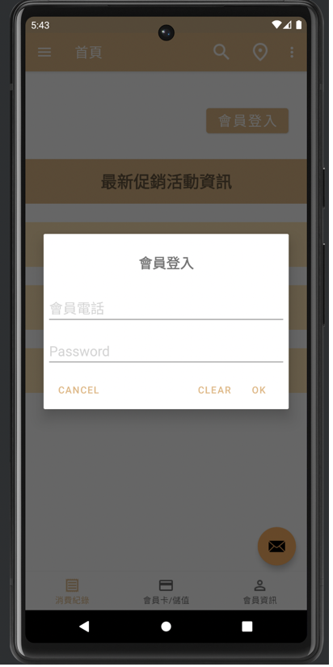
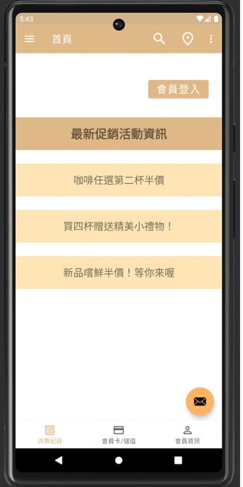
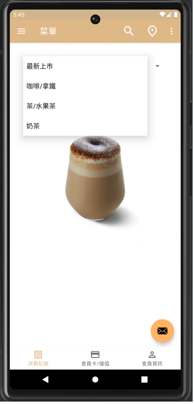
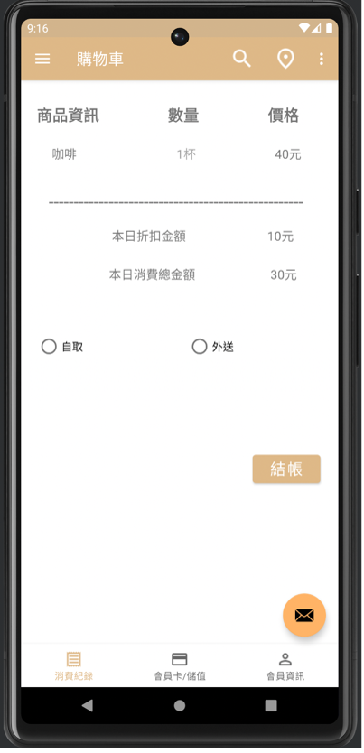

# MyCafe — Android 

## 專案介紹

MyCafe 是使用 Java 與 Android Studio 開發的咖啡店主題 Android App，為大學期間 Android 程式設計課程的實作專案。
本專案以咖啡店會員服務與商品瀏覽為設計情境，規劃會員登入、個人資料、商品菜單、購物車、會員卡及儲值等操作介面，並透過不同的 Android UI 元件實作頁面導覽與互動效果。

## 使用技術

| 技術 | 應用說明 |
|---|---|
| Java | Android App 功能與互動邏輯 |
| Android Studio | 應用程式開發與測試 |
| XML | 畫面配置與介面元件設計 |
| Android UI Components | Fragment、Dialog、Spinner、Toast 等介面元件 |
| Android Navigation | 側邊選單、底部導覽與頁面切換 |
| Intent | 開啟網頁搜尋、地圖及電子郵件應用程式 |

## 主要功能

### 1. 首頁與會員登入

- 顯示咖啡店最新促銷活動資訊。
- 使用 Dialog 設計會員登入介面。
- 透過 Toast 顯示操作提示訊息。

### 2. 商品菜單與購物車

- 使用 Spinner 切換不同飲品類別與商品圖片。
- 顯示商品資訊、數量、價格及折扣內容。
- 提供自取與外送選項，以及結帳操作介面。

### 3. 會員資訊與儲值

- 提供會員個人資料輸入介面。
- 使用 ImageView 顯示會員卡 QR Code。
- 透過 Dialog 呈現儲值金額輸入畫面。
- 展示會員消費紀錄及儲值紀錄。

### 4. 導覽與外部應用整合

- 使用 Navigation Drawer 與 Bottom Navigation 切換不同頁面。
- 透過 Intent 開啟 Google Maps、網頁搜尋及電子郵件應用程式。
- 使用 ScrollView 呈現較長的文字與紀錄內容。

## 🖥️ 系統畫面展示

### 首頁與會員登入

呈現咖啡店促銷資訊及會員登入對話框。

### 商品菜單與購物車

透過下拉式選單切換商品，並展示購物車及取貨方式選擇介面。

### 會員卡與儲值

展示會員 QR Code、儲值資訊及金額輸入對話框。

## 專案說明

本專案主要著重於 Android App 的介面設計與基本互動功能實作，部分會員登入、儲值、購物車及結帳操作為介面模擬，尚未整合實際會員驗證、交易處理及後端資料服務。

## 專案收穫

透過 MyCafe App 的開發，熟悉 Android Studio 的開發環境，以及 Java 與 XML 在 Android 應用程式中的使用方式，並累積多頁面介面設計、導覽功能與互動元件實作的經驗。
